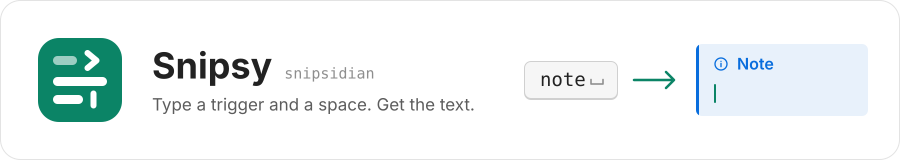
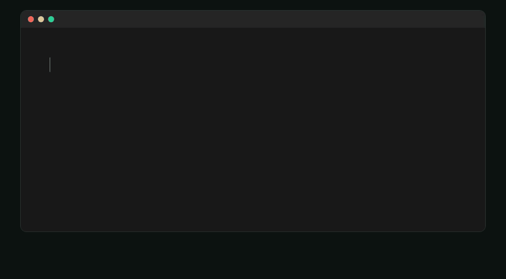
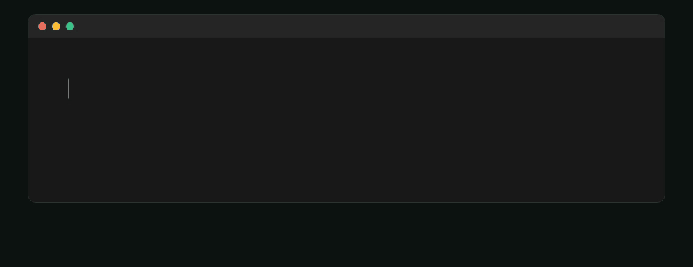
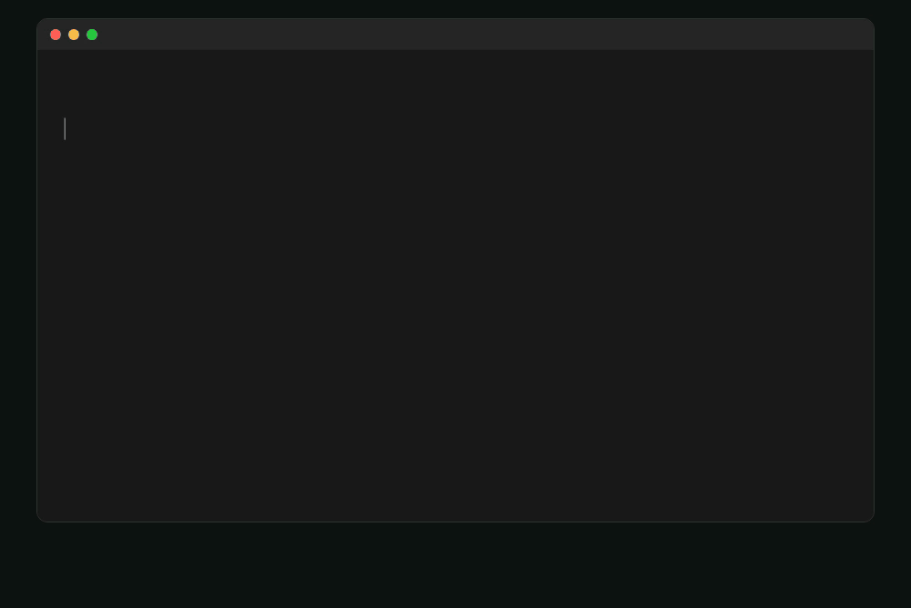
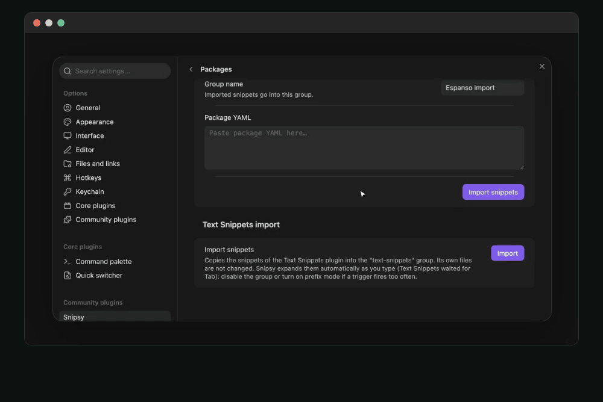

# Snipsy

<picture>
  <source media="(prefers-color-scheme: dark)" srcset="https://raw.githubusercontent.com/Dimagious/snipsidian/HEAD/docs/banner-dark.svg">
  
</picture>

Type `todo` and a space, get a task. Snipsy turns short triggers into text as you write in
Obsidian. **No scripting, and no templates to learn.**

**Install:** Settings → **Community plugins** → **Browse** → search for **Snipsy**. Then open a
note, type `todo` and a space.

[Website](https://dimagious.github.io/snipsidian/) · [60-second demo](https://github.com/Dimagious/snipsidian/blob/HEAD/docs/screens/demo.mp4) · [Full reference](https://github.com/Dimagious/snipsidian/blob/HEAD/docs/reference.md)

## Why Snipsy

- **It knows Markdown.** Triggers stay as you typed them in code blocks, inline code, math and
  frontmatter.
- **Only your typing fires it.** Paste, undo, another plugin's edit and IME composition expand
  nothing.
- **It works on your phone.** Same snippets, same picker.

## What you can do

**Find a snippet when you forget its trigger.** Run **Snipsy: Insert snippet…** to search
triggers and replacements, preview the result and insert it. You can give it a hotkey.

**Add your own.** Select text, run **Snipsy: Add snippet from selection** and type a trigger.
Symbols work too, so `->` can become `→`.

**Install a pack.** Twelve packs, one click each: Meetings, Daily Journal, Code Review, Symbols &
Math and more. Each pack gets its own group, so you can mute it or delete it whole.

**Take an expansion back.** Undo removes it in one step. Turn on **Highlight expansions** and
Backspace restores the trigger too.

**Stop accidental expansions.** Mute a group, or turn on prefix mode so only `:todo` expands and
`todo` stays a word.

## Coming from another tool

**Text Snippets.** Its last release was in May 2022. On the Packages page, press **Import** under
**Text Snippets import**. Snipsy shows a preview and copies your snippets into their own group,
without changing anything in Text Snippets. Two differences: Snipsy expands as you type instead of
waiting for Tab, and it has no tab stops.

**Espanso.** Paste the YAML of a package and name a group. Forms, scripts and other things Snipsy
can't represent are skipped and named.

**Other system-wide expanders.** Espanso, Raycast, Keyboard Maestro and AutoHotkey work in every
app, and Snipsy works only in Obsidian. Pick Snipsy for Markdown awareness and the same snippets on
your phone.

## What ships with it

Sixteen triggers in one group called **Defaults**. Type the trigger, then a space.

| Trigger | Becomes |
|---|---|
| `todo` · `done` | `- [ ] ` · `- [x] ` |
| `h1` · `h2` · `h3` | `# ` · `## ` · `### ` |
| `bold` · `italic` · `code` | `**\|**` · `_\|_` · `` `\|` ``, cursor inside |
| `note` | a `> [!note]` callout, cursor on the body line |
| `table` | a table, cursor in the first cell |
| `today` · `now` | `2026-09-28` · `14:05` |
| `brb` · `omw` · `ty` · `imo` | be right back · on my way · thank you · in my opinion |

Delete any of them. **Settings → Snipsy → Restore default snippets** brings back the missing ones.

## Placeholders

| Placeholder | Becomes |
|---|---|
| `$\|` | where the cursor lands |
| `$1` | the selected text, when you insert from the picker |
| `$date` · `$time` | today · now |
| `{{date:dddd, D MMMM}}` | your own [Moment.js format](https://momentjs.com/docs/#/displaying/format/) |
| `$filename` | the note's file name, with its extension |
| `$clipboard` | what is on your clipboard |

The [reference](https://github.com/Dimagious/snipsidian/blob/HEAD/docs/reference.md#placeholders) has the exact rules.

## What it does not do

- **JavaScript or dynamic templates:** use [Templater](https://github.com/SilentVoid13/Templater).
- **Expansion outside Obsidian:** use [Espanso](https://espanso.org/).
- **Regex triggers, or replacing text inside a word** (`y^2` into `y²`): use
  [Substitutions](https://github.com/BambusControl/obsidian-substitutions).
- **Tab stops that jump between fields.**

## Privacy

No analytics, no telemetry, no account. Snipsy goes online only when you open the Packages page, to
fetch the catalog from GitHub. Your snippets stay in the plugin's `data.json`.

## Questions

It keeps expanding <code>now</code> in my sentences

Delete that snippet, switch off the Defaults group, or turn on prefix mode so only `:now` expands.

My emoji snippets with colons (<code>:smile:</code>) don't expand

`:` is a separator, so `:smile:` can't be typed as one word. Settings → Snipsy → Snippets shows a
**Fix triggers** button that renames them to `smile` after a preview.

Triggers don't expand on Linux (Wayland)

Start Obsidian with `--ozone-platform=x11`. If that fixes it, please report it in an issue with your
desktop and input method.

## If something is wrong, or missing

[Open an issue](https://github.com/Dimagious/snipsidian/issues) with what you typed and what you
got. The feature list is short on purpose, and the fastest way to change it is to say what you
tried to do and could not.

If Snipsy saves you keystrokes, a [star on GitHub](https://github.com/Dimagious/snipsidian) helps
other people find it, and a [coffee](https://buymeacoffee.com/dimagious) says thanks.

**Also by the author:** [Dashy](https://dimagious.github.io/dashsidian/), a dashboard inside an
Obsidian note, built from seven Markdown blocks, with no JavaScript or Dataview.

Development commands are in the [reference](https://github.com/Dimagious/snipsidian/blob/HEAD/docs/reference.md#development).

## License

[MIT](LICENSE) © Dmitriy Yurkin
