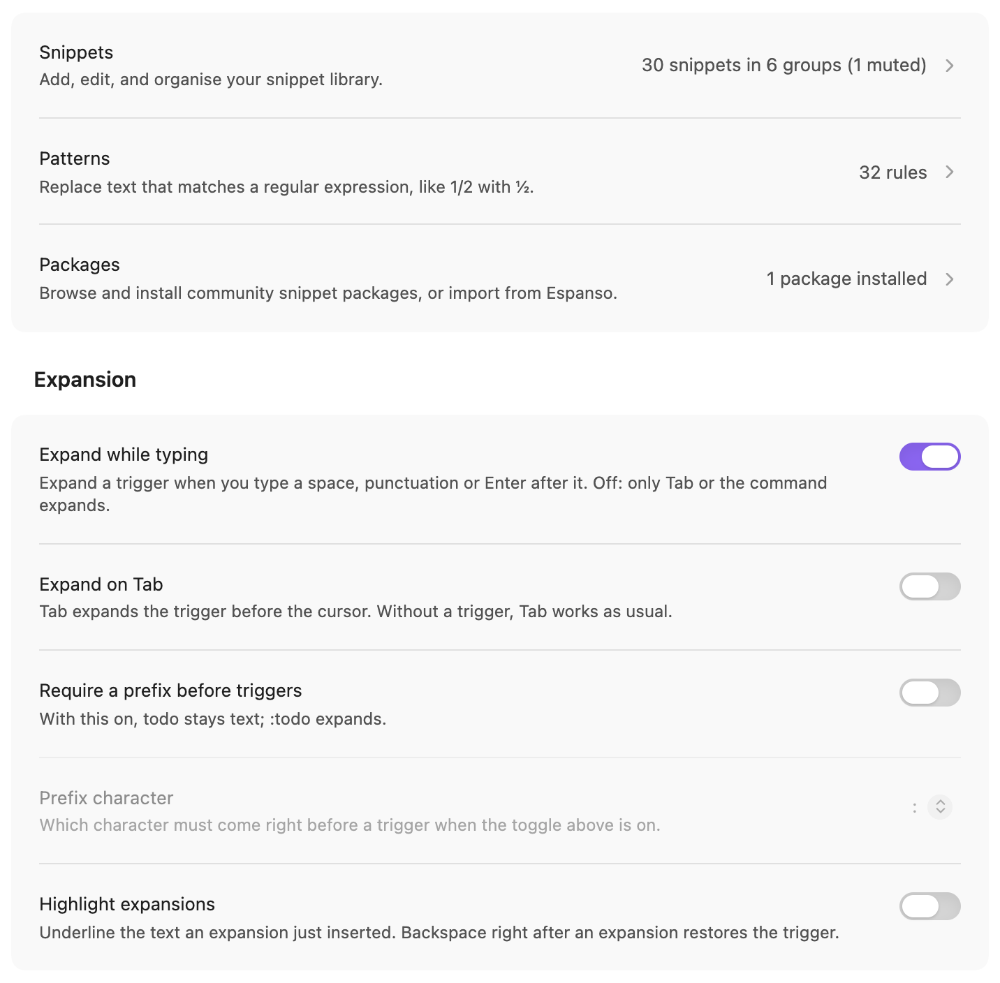
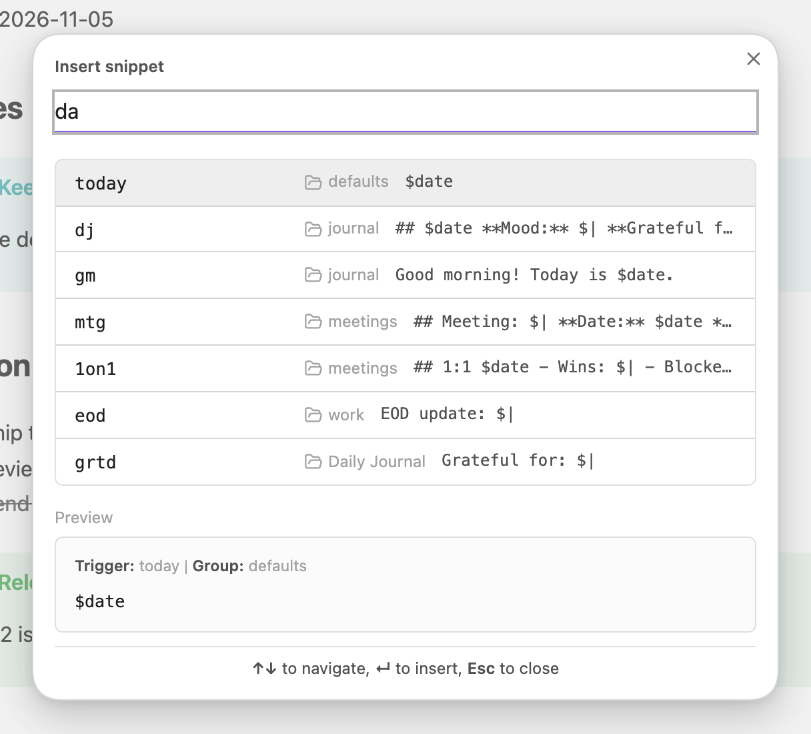
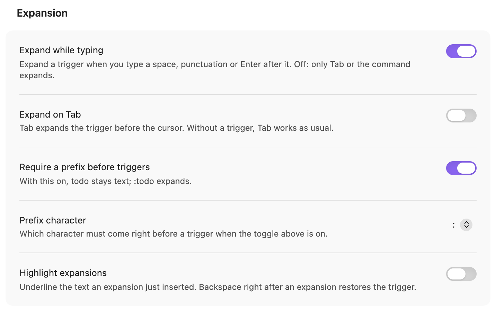
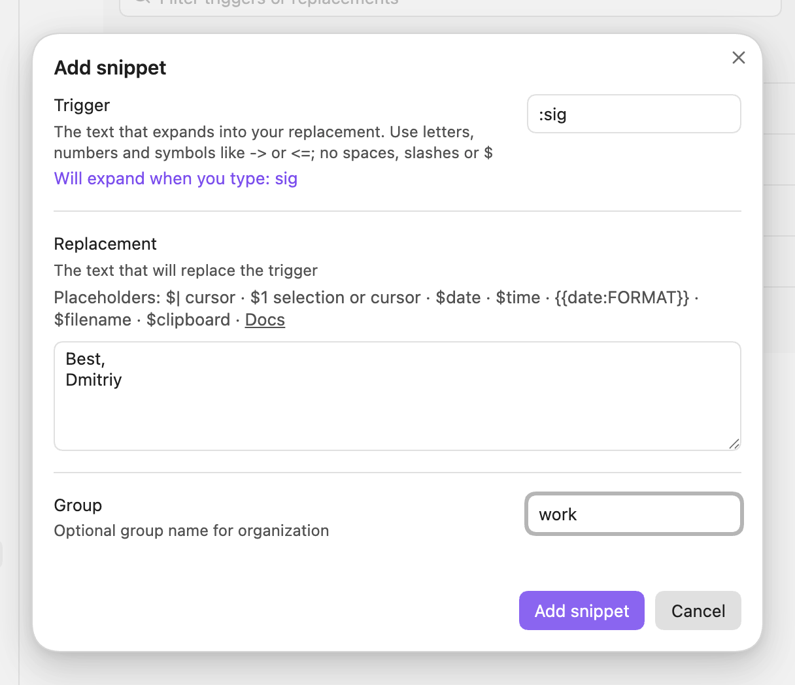
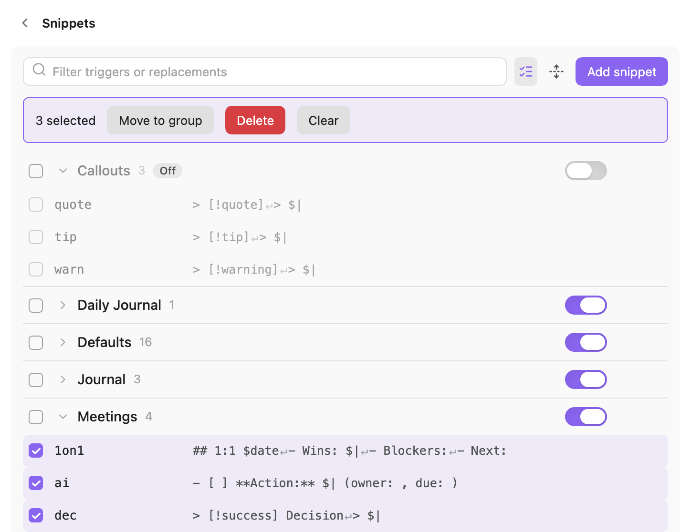
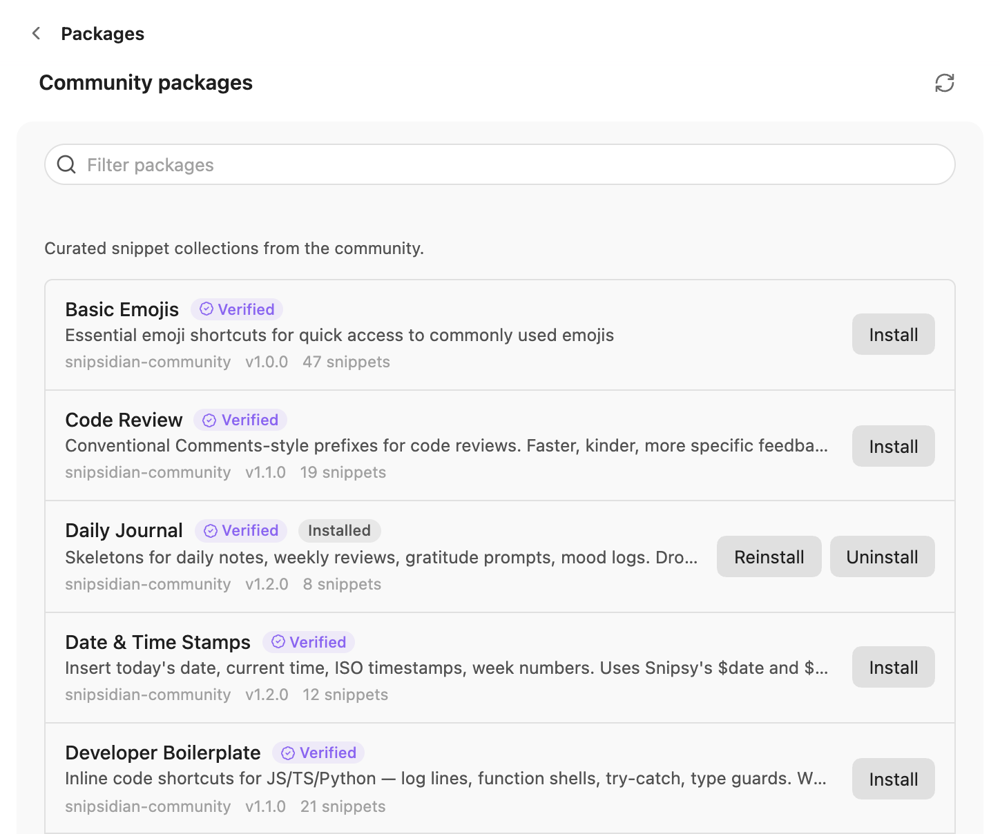
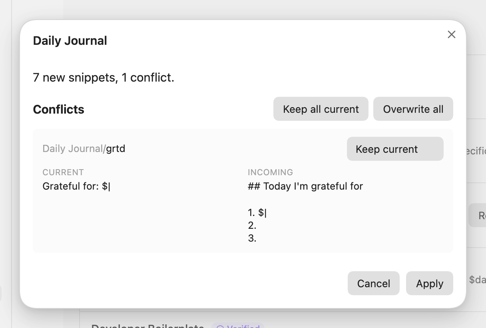
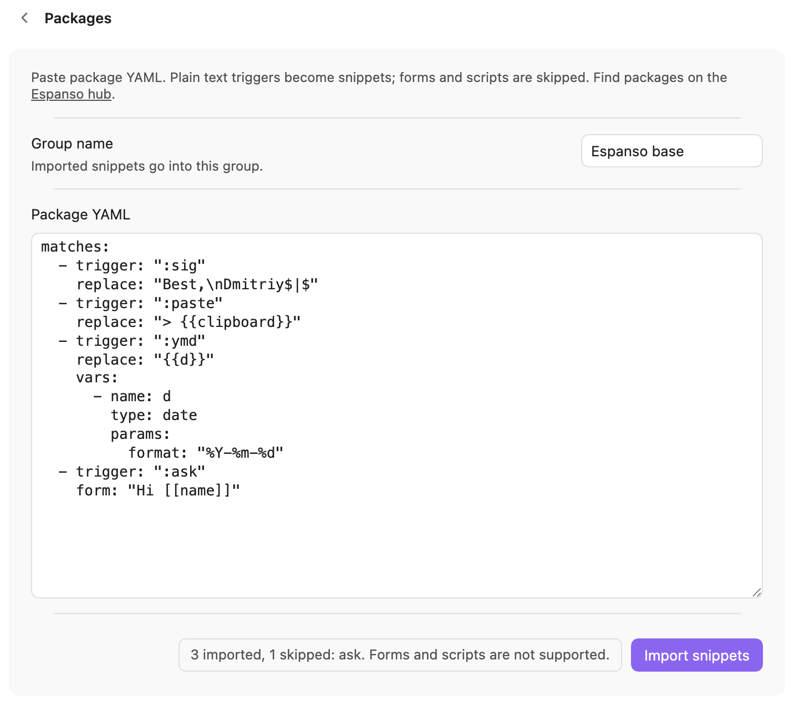

# Snipsy reference

Everything the [README](../README.md) leaves out: exact rules, edge cases, every import detail.

## Where triggers stay quiet

- **It reads markdown.** A trigger inside a fenced code block, inline code, math (`$…$`, `$$…$$`) or YAML
  frontmatter stays as you typed it. So does a trigger in the middle of a word.
  A `$` directly followed by a letter or symbol opens math (prices like `$5` don't) until the closing `$` on that line, or to the end of the line
  if there is none, so triggers don't expand there (`$HOME` in prose stops expansion for the rest of that
  line); write `\$` for a literal dollar.
- **Only your typing fires it.** Pasting text that ends in `todo `, undo, redo, drag and
  drop, another plugin's edit, IME composition for Chinese, Japanese or Korean: none of these
  expand anything.

## Commands and settings

For the snippets you do not remember by name, run **Snipsy: Insert snippet…** from the command
palette. It searches triggers and replacements, previews the result, and inserts at the cursor.
Select some text first and `$1` in the snippet receives it. **Settings → Snipsy → Set hotkey
for Insert snippet** opens the Hotkeys tab already filtered to that command.

**Snipsy: Expand trigger at cursor** expands the trigger that ends right at the caret, without
typing a separator. It follows the same rules as typing (code, math, frontmatter, prefix mode,
disabled groups). When there is no trigger at the caret but a field session is open, it jumps to the
next field, so one hotkey can do both. Otherwise it does nothing and shows nothing. It has no default
hotkey; assign one in Obsidian's Hotkeys. It expands only when the caret is at the end of the
trigger: inside a word (`sig|nature`) nothing happens, the next character has to be a separator or the
end of the line. **Snipsy: Next field** jumps to the next field of an open
session, for devices without a Tab key (add it to the mobile toolbar); with no session open it does
nothing. It has no default hotkey either.

To turn text you already wrote into a snippet, select it and run **Snipsy: Add snippet from
selection**. The Add snippet window opens with the replacement filled in from your selection;
type a trigger and save. The note is not changed.

On Obsidian 1.13 and later, Snipsy's settings are native: **Snippets** and **Packages** open as
pages, everything else sits right on the Snipsy settings screen, and Obsidian's settings search
finds them ("prefix", "hotstring", "export"). On older Obsidian the same settings are grouped
into Snippets, Packages, General and About tabs.

<picture>
  <source media="(prefers-color-scheme: dark)" srcset="https://raw.githubusercontent.com/Dimagious/snipsidian/HEAD/site/img/settings-root-dark.png">
  
</picture>

<picture>
  <source media="(prefers-color-scheme: dark)" srcset="https://raw.githubusercontent.com/Dimagious/snipsidian/HEAD/site/img/picker-dark.png">
  
</picture>

## How expansion works

A trigger expands when a separator lands after it: a space, Tab, Enter, or one of
`. , ! ? ; : ( ) [ ] { } " '`. The separator stays where you typed it.

```
You type:   todo·
You get:    - [ ] ·
```

`·` is the space you typed. Undo right after an expansion takes back the trigger and the
expansion together, in one step.

### Prefix mode

If `now` or `today` keeps turning into a time in the middle of your sentences, you have three
answers. Delete that one snippet. Switch off the whole Defaults group with the toggle on its
header. Or turn on **Require a prefix before triggers** under **Settings → Snipsy → Expansion**: from
then on `todo` stays a word, and only `:todo` (or `;todo`, your pick) expands. The prefix is
eaten by the expansion. It is one switch for every snippet, off by default.

<picture>
  <source media="(prefers-color-scheme: dark)" srcset="https://raw.githubusercontent.com/Dimagious/snipsidian/HEAD/site/img/prefix-dark.png">
  
</picture>

### Highlight expansions

Turn on **Highlight expansions** under **Settings → Snipsy → Expansion** (off by default) and every
expansion gets a dotted underline (the background flash is brief; the underline stays until you move the caret or type). While the mark is there, **Backspace** takes the
expansion back: `be right back·` turns into `brb·` exactly as you typed it (the space or punctuation
included), and the restored trigger does not expand again. Backspace is a normal Backspace as soon as
you move the caret, click, type or paste anything, so it never eats a character you meant to delete. Undo is not offered when Enter ends the trigger and
Obsidian continues a list or indentation on the new line. A snippet with fields (two or more of
`$1`..`$9`) gets no underline and no Backspace-undo: the caret moves into its first field at once,
which would clear the mark. Undo (Cmd/Ctrl+Z) still takes it back.

## Your own snippets

**Settings → Snipsy → Snippets → Add snippet.** Trigger `sig`, replacement:

```
Best,
Dmitriy
```

Save, and `sig` followed by a space is your signature in every note.

<picture>
  <source media="(prefers-color-scheme: dark)" srcset="https://raw.githubusercontent.com/Dimagious/snipsidian/HEAD/site/img/add-snippet-dark.png">
  
</picture>

### Trigger characters

A trigger can hold letters, digits, `_`, a leading `:`, and the symbols `- < > = + ~ * ^ | &`, so
`->`, `<=` or `--` work as triggers. Spaces, the separators listed above, `/`, `\` and `$` are not
allowed. A trigger still has to stand on its own: `--` expands on `--·` but not inside `---`.
A single `-`, `+`, `*`, `>` or `|` is not allowed either, since it would rewrite Markdown lists, quotes
and tables.

### Placeholders

| Placeholder | Becomes |
|---|---|
| `$\|` | where the cursor lands after expanding; with fields, the last stop Tab reaches |
| `$1`..`$9` | fields, see [Fields](#fields-tab-stops). From the picker over a selection, the first `$1` receives the selected text. A snippet with a single `$1` (and no other field) puts the caret there: `[$1](url)` puts the caret between the brackets, no Tab needed. Not a field: `$1` followed by a letter, digit or `_` (`$10`, `$1x`, `$1é`), by `.` or `,` and a digit (`$1.50`, `$1,000`), or inside a code block or `inline code`. `$5 each` is still a tabstop, so write `\$5` for a literal dollar amount |
| `$date` | today, `YYYY-MM-DD` |
| `$time` | now, `HH:mm` |
| `{{date}}`, `{{time}}` | today / now in `YYYY-MM-DD` / `HH:mm`, the same tokens as core Templates |
| `{{date:FORMAT}}`, `{{time:FORMAT}}` | your own [Moment.js format](https://momentjs.com/docs/#/displaying/format/), e.g. `{{date:dddd, D MMMM}}` gives `Tuesday, 2 September`; wrap literal text in `[ ]`. An empty format (`{{date:}}`) uses the default |
| `$filename` | the current note's file name, with its extension (`Meeting.md`) |
| `$clipboard` | what is on your clipboard at that moment |

### Fields (Tab stops)

Give a snippet two or more fields, `$1` to `$9`, and Tab walks through them: `[$1]($2)` expands
to `[]()` with the caret between the brackets; type the text, press Tab, type the address, press
Tab again and the caret leaves the snippet.

- **Order:** ascending number, and left to right for equal numbers. Each `$N` is its own stop: the
  same number twice is two stops, not one mirrored field.
- **Last stop:** the `$|` of the snippet. Without one, the caret ends up where it would be with no
  fields at all: right after the inserted text for **Expand trigger at cursor** and the picker, and
  after the separator you typed (the space, or the start of the next line after Enter) when the
  snippet expanded as you typed. Tab from the last field goes there and ends the session.
- **Keys:** Tab next, Shift+Tab previous (it stays on the first), Escape ends the session. These
  keys are taken only while a session is open, so a list item still indents on Tab and other plugins
  keep their Tab. Clicking or arrowing out of the fields ends the session too, and
  expanding a snippet with fields replaces it (a plain or one-field snippet expanded inside the
  current field keeps it); switching to the Command Palette or another app does not. Typing inside a field makes it longer; going back to a field you filled selects its
  text.
- **Look:** an empty field shows as a small underlined slot, a filled one with a soft background.
  Nothing is written into the note, and nothing is left behind when the session ends.
- **One field is not a session:** a snippet with a single `$1` behaves as before, the caret lands
  there and Tab is not involved. Combine it with `$|` and `$|` wins.
- **Picker:** inserting over a selection puts the selection into the first `$1`; the session starts
  at the next field.
- **No keyboard:** run **Snipsy: Next field** from the toolbar or a hotkey.

### Groups

Every snippet lives in a group. Packs and imports each get their own, so a whole pack comes
out the way it went in: delete its group. The toggle on a group's header mutes it without
deleting anything: its snippets stop expanding and leave the picker, and stay in the list,
dimmed, for when you want them back. Selection mode moves or deletes many at once; a delete
names the first five triggers before it asks.

<picture>
  <source media="(prefers-color-scheme: dark)" srcset="https://raw.githubusercontent.com/Dimagious/snipsidian/HEAD/site/img/groups-dark.png">
  
</picture>

## Packages

### Community catalog

**Settings → Snipsy → Packages.** Thirteen packs, one click each:

| | |
|---|---|
| Markdown Essentials | Obsidian Power-User |
| Daily Journal | GTD & Productivity |
| Meetings | Developer Boilerplate |
| Code Review | Research & Academic |
| Symbols & Math | Date & Time |
| Obsidian Callouts | Basic Emojis |
| Typography | |

Reinstalling a pack whose snippets you have edited opens a preview before anything is written:
keep your version or take the pack's, snippet by snippet. A pack that wants a trigger already
used by a different snippet in another group is not installed, and the notice names the
trigger. The catalog lives in
[Dimagious/snipsidian-community](https://github.com/Dimagious/snipsidian-community). Made a pack
worth sharing? The Packages page opens a GitHub issue with it already filled in.

<picture>
  <source media="(prefers-color-scheme: dark)" srcset="https://raw.githubusercontent.com/Dimagious/snipsidian/HEAD/site/img/packages-dark.png">
  
</picture>

<picture>
  <source media="(prefers-color-scheme: dark)" srcset="https://raw.githubusercontent.com/Dimagious/snipsidian/HEAD/site/img/conflict-dark.png">
  
</picture>

### Package format

A pack is one YAML file. This is what **Share a package** on the Packages page checks before it
opens the GitHub issue:

```yaml
name: "Typography"            # 3 to 50 characters
version: "1.0.0"              # semantic version
author: "your-name"           # 3 to 50 characters
description: "Arrows and dashes from the characters you already type."  # 10 to 200
category: "symbols"           # optional, see below
tags: ["symbols", "arrows"]   # optional
snippets:                     # a list, not a map
  - trigger: "->"
    replace: "→"
  - trigger: "mtg"
    replace: "Meeting with $1 at $2$|"
    description: "Meeting line"   # optional
```

- `name` takes letters, digits, spaces, `-`, `_` and `&`; `author` the same without `&`.
- `category` is one of `markdown`, `programming`, `academic`, `business`, `creative`, `productivity`,
  `language`, `other`, `development`, `emojis`, `journaling`, `obsidian`, `research`, `symbols`,
  `utility`, `work`.
- Triggers follow the [trigger rules](#trigger-characters) and are 1 to 50 characters; a
  replacement is up to 10,000 characters and can use every [placeholder](#placeholders). For a
  line break, write the text on several lines with `|-`, as in the
  [approved packs](https://github.com/Dimagious/snipsidian-community/tree/main/community-packages/approved).
- An install takes at most 500 snippets and 2 MiB of text.

### Espanso import

Paste the YAML of any package from [hub.espanso.org](https://hub.espanso.org/), name a group,
press **Import snippets**. Espanso's cursor marker, clipboard variable and plain date variable
become `$|`, `$clipboard` and `$date`. Forms, scripts, shell commands, regex triggers and images
have no equivalent here. Those are skipped and named, "12 imported, 3 skipped: …", instead of
landing in your notes as broken `{{text}}`.

<picture>
  <source media="(prefers-color-scheme: dark)" srcset="https://raw.githubusercontent.com/Dimagious/snipsidian/HEAD/site/img/espanso-dark.png">
  
</picture>

### Text Snippets import

Coming from the Text Snippets plugin (`text-snippets-obsidian`)? Press **Import** under
**Text Snippets import** on the Packages page. Snipsy reads that plugin's saved snippets, shows
what it cannot take, shows a preview, and installs the rest into a `text-snippets` group once you
press **Apply**. Nothing in the other plugin is changed. `$end$` becomes `$|`, `$pst$` becomes
`$clipboard`, `$nl$` becomes a line break, and `$tb$` tab stops become fields `$1`, `$2`... in the order they appear (Tab walks
them, see [Fields](#fields-tab-stops); up to nine, the rest are removed and named). Your custom marker symbols are honored. If a trigger
appears twice, the later one wins, like it does there, and the plugin's default sample snippet is
skipped. A few small deviations are deliberate: a second `$end$` is removed (the original left it as
text), every `$pst$` is replaced, triggers are trimmed and a leading or trailing `:` is stripped, text after
a second ` : ` is kept, and a snippet with `$end$` and tab stops ends at `$end$` after the last field.
A tab stop glued to a letter, digit or backslash (`a$tb$b`) cannot be a field in Snipsy. With no
`$end$` the first such stop becomes the cursor, as before fields existed (`a$tb$b` becomes `a$|b`);
any other one is removed with a warning, so a snippet that relies on several glued stops loses all
but the first. A single tab stop next to `$end$` is ignored because one field is only the caret.
A literal `$1`..`$9` in a snippet that also has tab stops is escaped (`\$5`) and reported, so it
stays text. Tab stops inside fenced code or inline code are literal in Snipsy, so they are treated
like glued ones (the first becomes the cursor, any other is removed with a warning).
Triggers in any language are kept (`прив`, `δ`, `café`, `日付`), normalised so an accent typed in the
editor matches whichever way the keyboard composes it. Triggers with spaces, `/`, `$`, emoji, other
symbols (besides `< > = + ~ * ^ | &`) or other characters Snipsy does not allow are skipped and named. That includes triggers with
an invisible character (a joiner such as ZWNJ U+200C or ZWJ U+200D, as in Persian `می‌خواهم` or Indic
conjuncts, a soft hyphen, a zero-width space); the reason names the character.
Snipsy ends a word at its own fixed separators (space, Tab, Enter, `. , ! ? ; : ( ) [ ] { } " '`; the
ideographic space U+3000 does not count), so a trigger expands only after one of them, and it must start at the line start or right after a
separator. CJK or Arabic punctuation such as `。` or `،` does not end a trigger, same as for
hand-added triggers, and a trigger inside unspaced CJK text does not fire (`今日の 日付` works,
`今日の日付` does not). The "Expand trigger at cursor" command expands a trigger with no separator
typed after it, when the caret is at the end of the line or before one of Snipsy's separators; it
follows the same start rule. If you changed the word delimiters in Text Snippets, the import says so.
Snipsy expands these automatically as you type (Text Snippets waited for Tab), so disable the group
or turn on prefix mode if a trigger fires too often.

### Backup

**Settings → Snipsy → Export snippets** saves every snippet to a JSON file, **Import snippets**
brings them back. On
a phone, where browsers cannot download, the export lands in the vault root as
`snipsidian-snippets.json`.

## Privacy

Snipsy reads and writes one file: `.obsidian/plugins/snipsidian/data.json`. It goes online
only when you open the Packages page: `api.github.com` for the list and
`raw.githubusercontent.com` for the pack files, all of them, kept for 24 hours. No analytics, no
telemetry, no account.

`$clipboard` reads your clipboard when a snippet with it expands. None of the defaults use it;
the install preview shows it when a third-party pack does.

## Questions

<details>
<summary>Will it fire inside my code blocks?</summary>

No. Fenced code, inline code and YAML frontmatter are left alone, and so is a trigger that
is part of a longer word.

</details>

<details>
<summary>It keeps expanding <code>now</code> in my sentences</summary>

Delete that snippet, switch off the Defaults group, or turn on prefix mode so only `:now`
expands. See [Prefix mode](#prefix-mode).

</details>

<details>
<summary>My emoji snippets with colons (<code>:smile:</code>) don't expand</summary>

`:` is a separator, so a stored trigger like `:smile:` can never be typed as one word. Settings →
Snipsy → Snippets shows a warning with a **Fix triggers** button that renames them to `smile` (same group,
same replacement) after a preview. Triggers that would clash with an existing one are skipped and
listed. With [prefix mode](#prefix-mode) set to `:`, you then type `:smile `.

</details>

<details>
<summary>Triggers don't expand on Linux (Wayland)</summary>

Start Obsidian with `--ozone-platform=x11`. If that fixes it, please report it in an issue
with your desktop and input method.

</details>

<details>
<summary>Does it work on my phone?</summary>

Yes. The plugin is not desktop-only, and the picker fits a phone screen.

</details>

<details>
<summary>Are <code>$1</code> and <code>$2</code> Tab-stops?</summary>

Yes, when a snippet has two or more of them: Tab jumps from one to the next, then to `$|` or the
end of the snippet. A snippet with a single `$1` just puts the caret there. `$1` also takes the
selected text when you insert from the picker over a selection. See
[Fields](#fields-tab-stops).

</details>

<details>
<summary>Where are my snippets, and do they sync?</summary>

In `.obsidian/plugins/snipsidian/data.json` inside the vault. iCloud, Syncthing or git carry it with
the rest of the vault; Obsidian Sync carries it when syncing of community plugin settings is on.
**Export snippets** saves a copy you can keep elsewhere.

</details>

<details>
<summary>How do I start over?</summary>

Export your snippets first. Then **Settings → Snipsy → Restore default snippets** brings back the
sixteen defaults you deleted, without touching your own. For a full reset, close Obsidian, delete
`data.json` and import the export again where you need it.

</details>

<details>
<summary>Does it send my notes anywhere?</summary>

No. See [Privacy](#privacy).

</details>

## Development

```bash
npm install
npm test           # vitest, with coverage gates
npm run lint       # eslint + eslint-plugin-obsidianmd
npm run typecheck  # src and the e2e specs
npm run build      # main.js + styles.css
```

| | |
|---|---|
| `npm run e2e` | the suite against a real Obsidian |
| `npm run capture` | retakes the site pictures (`site/img/*-light.png`, `*-dark.png`) and the directory listing pictures (`docs/listing/`) from the real Obsidian on a fixed day (`e2e/capture.spec.ts`), then `opdk demo` copies them. The listing itself is updated by hand. The spec is skipped by `npm run e2e` |
| `npm run scorecard:check` | `opdk scan`: mirrors the community-plugin review scanner |
| `npm run release:check` | `opdk release check` (versions, `versions.json`, manifest, CHANGELOG, a reproducible build), the scan, lint, typecheck, tests and the site check |

`VAULT_PLUGIN="/path/to/vault/.obsidian/plugins/snipsidian" npm run dev:vault` builds straight
into a test vault and watches for changes.

The matching engine lives in `src/engine/`, which imports neither Obsidian nor the DOM and is
tested without mocks.
