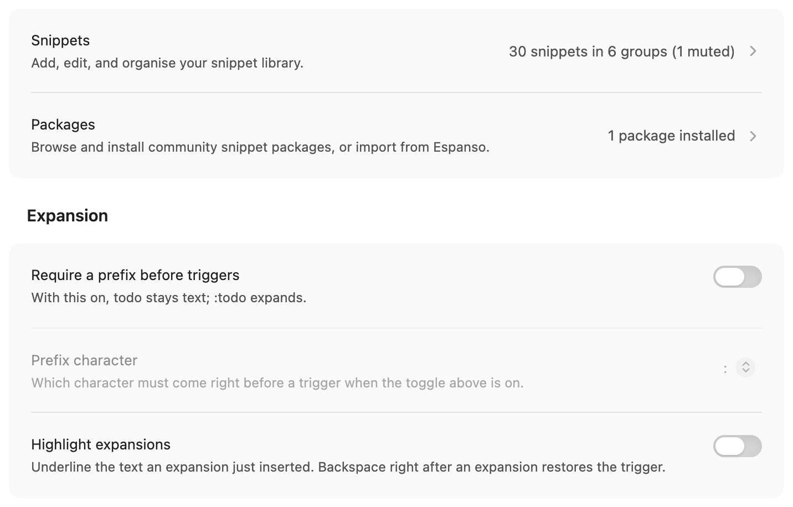
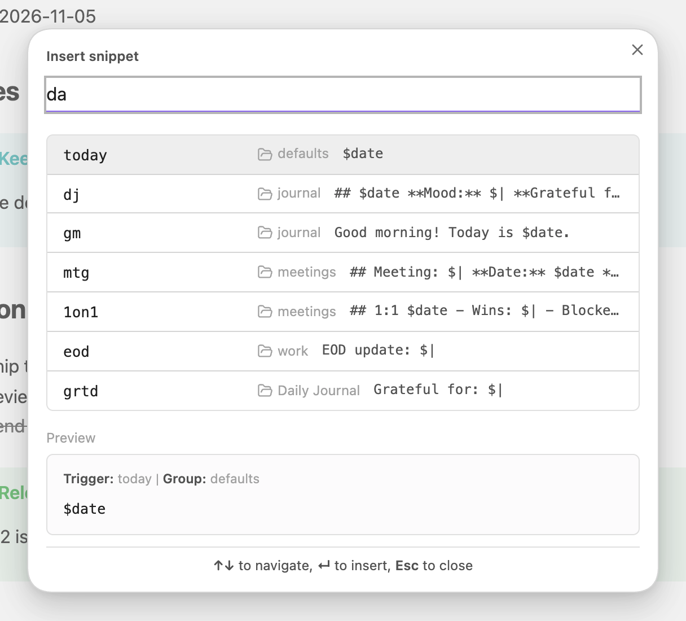
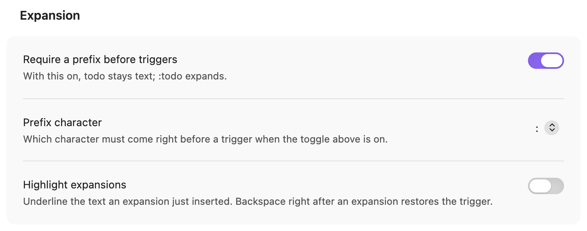
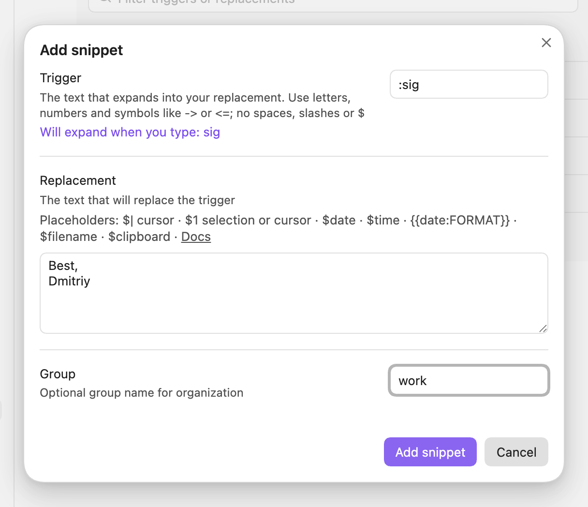
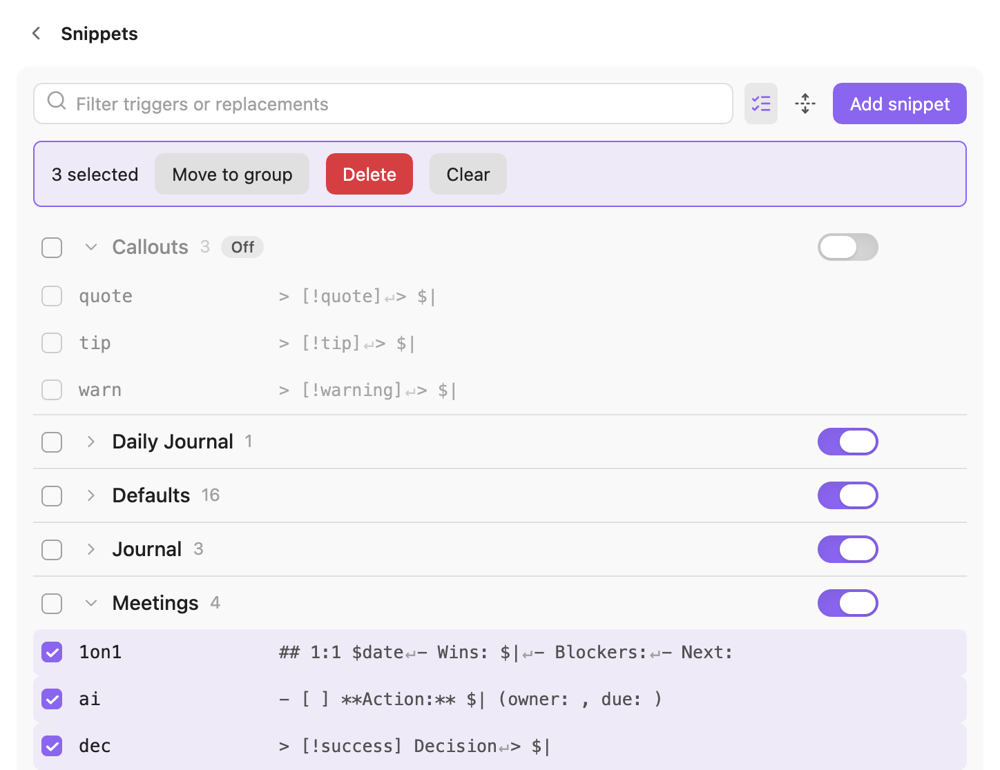
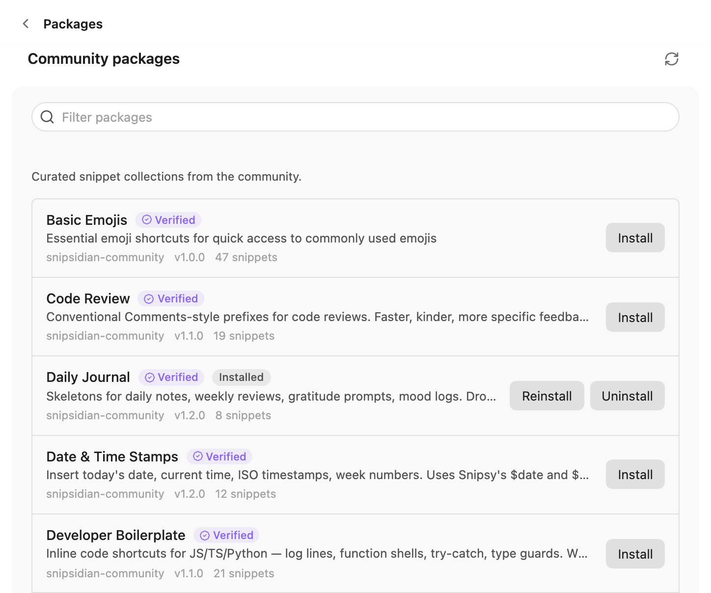
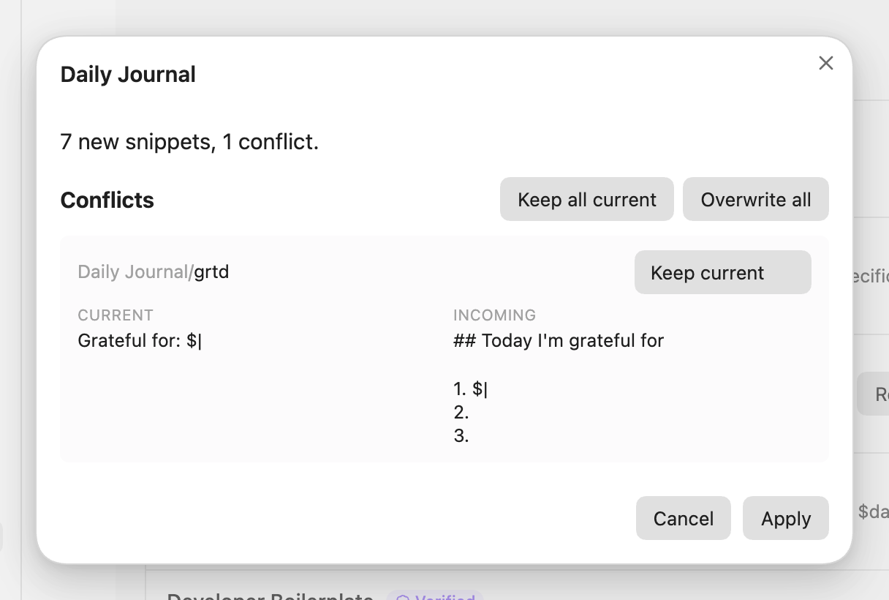
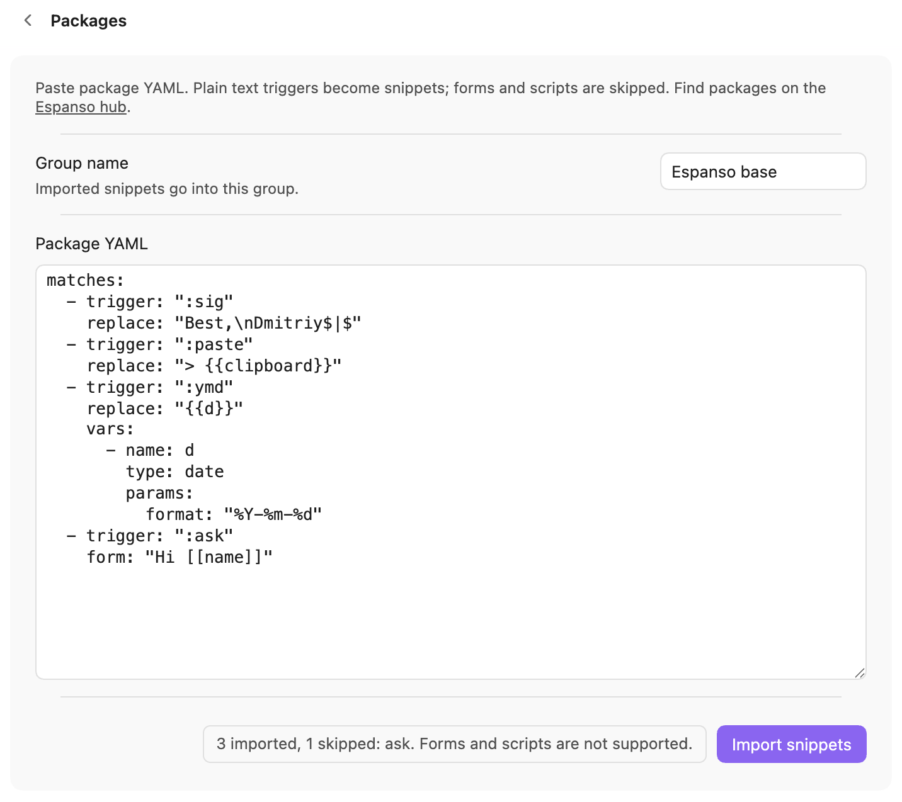

# Snipsy reference

Everything the [README](../README.md) leaves out: exact rules, edge cases, every import detail.

## Where triggers stay quiet

- **It reads markdown.** A trigger inside a fenced code block, inline code, math (`$…$`, `$$…$$`) or YAML
  frontmatter stays as you typed it. So does a trigger in the middle of a word.
  A `$` directly followed by a letter or symbol opens math (prices like `$5` don't) until the closing `$` on that line, or to the end of the line
  if there is none, so triggers don't expand there (`$HOME` in prose stops expansion for the rest of that
  line); write `\$` for a literal dollar.
- **Only your typing fires it.** Pasting text that ends in `todo `, undo, redo, drag and
  drop, another plugin's edit, IME composition for Chinese, Japanese or Korean: none of these
  expand anything.

## Commands and settings

For the snippets you do not remember by name, run **Snipsy: Insert snippet…** from the command
palette. It searches triggers and replacements, previews the result, and inserts at the cursor.
Select some text first and `$1` in the snippet receives it. **Settings → Snipsy → Set hotkey
for Insert snippet** opens the Hotkeys tab already filtered to that command.

To turn text you already wrote into a snippet, select it and run **Snipsy: Add snippet from
selection**. The Add snippet window opens with the replacement filled in from your selection;
type a trigger and save. The note is not changed.

On Obsidian 1.13 and later, Snipsy's settings are native: **Snippets** and **Packages** open as
pages, everything else sits right on the Snipsy settings screen, and Obsidian's settings search
finds them ("prefix", "hotstring", "export"). On older Obsidian the same settings are grouped
into Snippets, Packages, General and About tabs.

<picture>
  <source media="(prefers-color-scheme: dark)" srcset="https://raw.githubusercontent.com/Dimagious/snipsidian/HEAD/site/img/settings-root-dark.png">
  
</picture>

<picture>
  <source media="(prefers-color-scheme: dark)" srcset="https://raw.githubusercontent.com/Dimagious/snipsidian/HEAD/site/img/picker-dark.png">
  
</picture>

## How expansion works

A trigger expands when a separator lands after it: a space, Tab, Enter, or one of
`. , ! ? ; : ( ) [ ] { } " '`. The separator stays where you typed it.

```
You type:   todo·
You get:    - [ ] ·
```

`·` is the space you typed. Undo right after an expansion takes back the trigger and the
expansion together, in one step.

### Prefix mode

If `now` or `today` keeps turning into a time in the middle of your sentences, you have three
answers. Delete that one snippet. Switch off the whole Defaults group with the toggle on its
header. Or turn on **Require a prefix before triggers** under **Settings → Snipsy → Expansion**: from
then on `todo` stays a word, and only `:todo` (or `;todo`, your pick) expands. The prefix is
eaten by the expansion. It is one switch for every snippet, off by default.

<picture>
  <source media="(prefers-color-scheme: dark)" srcset="https://raw.githubusercontent.com/Dimagious/snipsidian/HEAD/site/img/prefix-dark.png">
  
</picture>

### Highlight expansions

Turn on **Highlight expansions** under **Settings → Snipsy → Expansion** (off by default) and every
expansion gets a dotted underline (the background flash is brief; the underline stays until you move the caret or type). While the mark is there, **Backspace** takes the
expansion back: `be right back·` turns into `brb·` exactly as you typed it (the space or punctuation
included), and the restored trigger does not expand again. Backspace is a normal Backspace as soon as
you move the caret, click, type or paste anything, so it never eats a character you meant to delete. Undo is not offered when Enter ends the trigger and
Obsidian continues a list or indentation on the new line.

## Your own snippets

**Settings → Snipsy → Snippets → Add snippet.** Trigger `sig`, replacement:

```
Best,
Dmitriy
```

Save, and `sig` followed by a space is your signature in every note.

<picture>
  <source media="(prefers-color-scheme: dark)" srcset="https://raw.githubusercontent.com/Dimagious/snipsidian/HEAD/site/img/add-snippet-dark.png">
  
</picture>

### Trigger characters

A trigger can hold letters, digits, `_`, a leading `:`, and the symbols `- < > = + ~ * ^ | &`, so
`->`, `<=` or `--` work as triggers. Spaces, the separators listed above, `/`, `\` and `$` are not
allowed. A trigger still has to stand on its own: `--` expands on `--·` but not inside `---`.
A single `-`, `+`, `*`, `>` or `|` is not allowed either, since it would rewrite Markdown lists, quotes
and tables.

### Placeholders

| Placeholder | Becomes |
|---|---|
| `$\|` | where the cursor lands after expanding |
| `$1` | the selected text, when you insert the snippet from the picker over a selection. Otherwise it is the cursor when the snippet has no `$\|`: `[$1](url)` puts the caret between the brackets. Further `$1`..`$9` are dropped. Not a tabstop: `$1` followed by a letter, digit or `_` (`$10`, `$1x`, `$1é`), by `.` or `,` and a digit (`$1.50`, `$1,000`), or inside a code block or `inline code`. `$5 each` is still a tabstop, so write `\$5` for a literal dollar amount |
| `$date` | today, `YYYY-MM-DD` |
| `$time` | now, `HH:mm` |
| `{{date}}`, `{{time}}` | today / now in `YYYY-MM-DD` / `HH:mm`, the same tokens as core Templates |
| `{{date:FORMAT}}`, `{{time:FORMAT}}` | your own [Moment.js format](https://momentjs.com/docs/#/displaying/format/), e.g. `{{date:dddd, D MMMM}}` gives `Tuesday, 2 September`; wrap literal text in `[ ]`. An empty format (`{{date:}}`) uses the default |
| `$filename` | the current note's file name, with its extension (`Meeting.md`) |
| `$clipboard` | what is on your clipboard at that moment |

### Groups

Every snippet lives in a group. Packs and imports each get their own, so a whole pack comes
out the way it went in: delete its group. The toggle on a group's header mutes it without
deleting anything: its snippets stop expanding and leave the picker, and stay in the list,
dimmed, for when you want them back. Selection mode moves or deletes many at once; a delete
names the first five triggers before it asks.

<picture>
  <source media="(prefers-color-scheme: dark)" srcset="https://raw.githubusercontent.com/Dimagious/snipsidian/HEAD/site/img/groups-dark.png">
  
</picture>

## Packages

### Community catalog

**Settings → Snipsy → Packages.** Thirteen packs, one click each:

| | |
|---|---|
| Markdown Essentials | Obsidian Power-User |
| Daily Journal | GTD & Productivity |
| Meetings | Developer Boilerplate |
| Code Review | Research & Academic |
| Symbols & Math | Date & Time |
| Obsidian Callouts | Basic Emojis |
| Typography | |

Reinstalling a pack whose snippets you have edited opens a preview before anything is written:
keep your version or take the pack's, snippet by snippet. A pack that wants a trigger already
used by a different snippet in another group is not installed, and the notice names the
trigger. The catalog lives in
[Dimagious/snipsidian-community](https://github.com/Dimagious/snipsidian-community). Made a pack
worth sharing? The Packages page opens a GitHub issue with it already filled in.

<picture>
  <source media="(prefers-color-scheme: dark)" srcset="https://raw.githubusercontent.com/Dimagious/snipsidian/HEAD/site/img/packages-dark.png">
  
</picture>

<picture>
  <source media="(prefers-color-scheme: dark)" srcset="https://raw.githubusercontent.com/Dimagious/snipsidian/HEAD/site/img/conflict-dark.png">
  
</picture>

### Espanso import

Paste the YAML of any package from [hub.espanso.org](https://hub.espanso.org/), name a group,
press **Import snippets**. Espanso's cursor marker, clipboard variable and plain date variable
become `$|`, `$clipboard` and `$date`. Forms, scripts, shell commands, regex triggers and images
have no equivalent here. Those are skipped and named, "12 imported, 3 skipped: …", instead of
landing in your notes as broken `{{text}}`.

<picture>
  <source media="(prefers-color-scheme: dark)" srcset="https://raw.githubusercontent.com/Dimagious/snipsidian/HEAD/site/img/espanso-dark.png">
  
</picture>

### Text Snippets import

Coming from the Text Snippets plugin (`text-snippets-obsidian`)? Press **Import** under
**Text Snippets import** on the Packages page. Snipsy reads that plugin's saved snippets, shows
what it cannot take, shows a preview, and installs the rest into a `text-snippets` group once you
press **Apply**. Nothing in the other plugin is changed. `$end$` becomes `$|`, `$pst$` becomes
`$clipboard`, `$nl$` becomes a line break, and `$tb$` tab stops are dropped (Snipsy has none; with
no `$end$`, the first one becomes the cursor). Your custom marker symbols are honored. If a trigger
appears twice, the later one wins, like it does there, and the plugin's default sample snippet is
skipped. A few small deviations are deliberate: a second `$end$` is removed (the original left it as
text), every `$pst$` is replaced, triggers are trimmed and a leading or trailing `:` is stripped, text after
a second ` : ` is kept, and a snippet with both `$end$` and `$tb$` puts the cursor at `$end$` (the
original jumped to the first tab stop). Triggers with spaces or characters Snipsy does not allow are
skipped and named. Snipsy expands these automatically as you type (Text Snippets waited for Tab),
so disable the group or turn on prefix mode if a trigger fires too often.

### Backup

**Settings → Snipsy → Export snippets** saves every snippet to a JSON file, **Import snippets**
brings them back. On
a phone, where browsers cannot download, the export lands in the vault root as
`snipsidian-snippets.json`.

## Privacy

Snipsy reads and writes one file: `.obsidian/plugins/snipsidian/data.json`. It goes online
only when you open the Packages page, to `api.github.com` for the list and
`raw.githubusercontent.com` for the pack you install. No analytics, no telemetry, no account.

`$clipboard` reads your clipboard when a snippet with it expands. None of the defaults use it;
the install preview shows it when a third-party pack does.

## Questions

<details>
<summary>Will it fire inside my code blocks?</summary>

No. Fenced code, inline code and YAML frontmatter are left alone, and so is a trigger that
is part of a longer word.

</details>

<details>
<summary>It keeps expanding <code>now</code> in my sentences</summary>

Delete that snippet, switch off the Defaults group, or turn on prefix mode so only `:now`
expands. See [Prefix mode](#prefix-mode).

</details>

<details>
<summary>My emoji snippets with colons (<code>:smile:</code>) don't expand</summary>

`:` is a separator, so a stored trigger like `:smile:` can never be typed as one word. Settings →
Snipsy → Snippets shows a warning with a **Fix triggers** button that renames them to `smile` (same group,
same replacement) after a preview. Triggers that would clash with an existing one are skipped and
listed. With [prefix mode](#prefix-mode) set to `:`, you then type `:smile `.

</details>

<details>
<summary>Triggers don't expand on Linux (Wayland)</summary>

Start Obsidian with `--ozone-platform=x11`. If that fixes it, please report it in an issue
with your desktop and input method.

</details>

<details>
<summary>Does it work on my phone?</summary>

Yes. The plugin is not desktop-only, and the picker fits a phone screen.

</details>

<details>
<summary>Are <code>$1</code> and <code>$2</code> Tab-stops?</summary>

No. `$1` takes the selected text when you insert from the picker. There is no jumping between
fields with Tab, by design.

</details>

<details>
<summary>Does it send my notes anywhere?</summary>

No. See [Privacy](#privacy).

</details>

## Development

```bash
npm install
npm test           # vitest, with coverage gates
npm run lint       # eslint + eslint-plugin-obsidianmd
npm run typecheck  # src and the e2e specs
npm run build      # main.js + styles.css
```

| | |
|---|---|
| `npm run e2e` | the suite against a real Obsidian |
| `npm run capture` | retakes the site pictures (`site/img/*-light.png`, `*-dark.png`) from the real Obsidian on a fixed day (`e2e/capture.spec.ts`), then `opdk demo` copies them. The spec is skipped by `npm run e2e` |
| `npm run scorecard:check` | `opdk scan`: mirrors the community-plugin review scanner |
| `npm run release:check` | `opdk release check` (versions, `versions.json`, manifest, CHANGELOG, a reproducible build), the scan, lint, typecheck, tests and the site check |

`VAULT_PLUGIN="/path/to/vault/.obsidian/plugins/snipsidian" npm run dev:vault` builds straight
into a test vault and watches for changes.

The matching engine lives in `src/engine/`, which imports neither Obsidian nor the DOM and is
tested without mocks.
